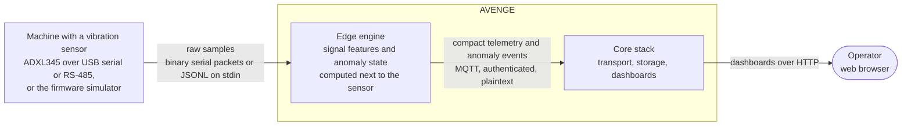
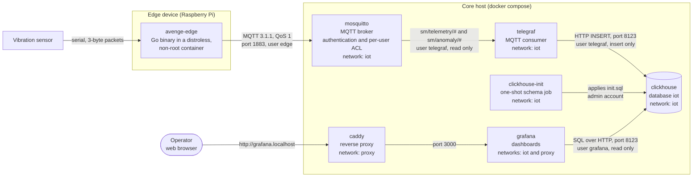
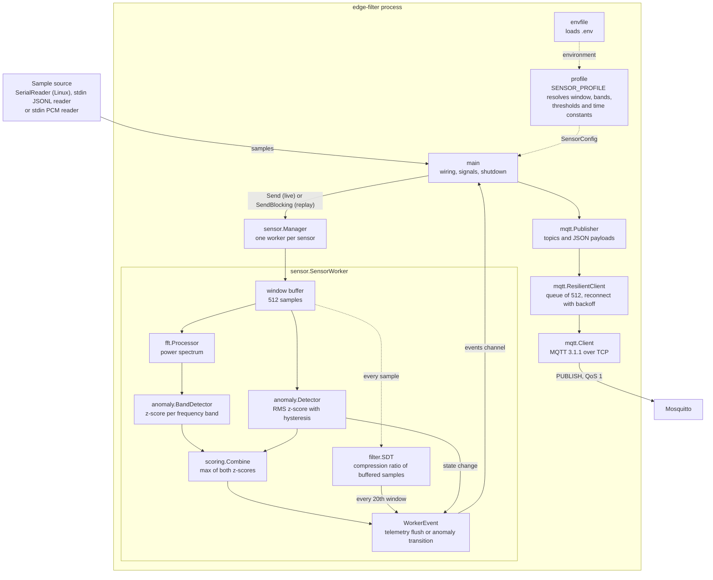
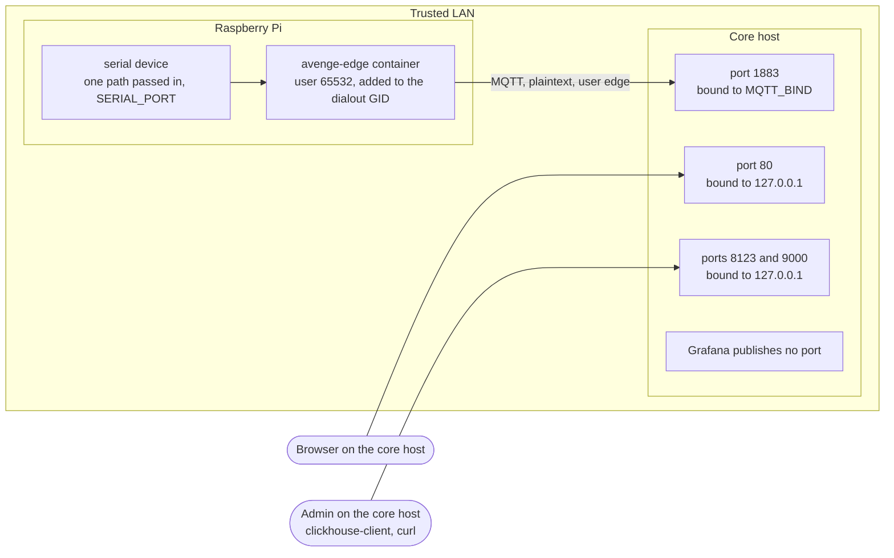
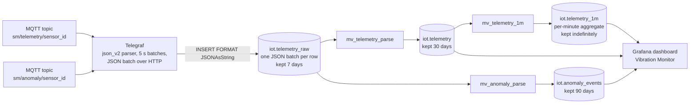
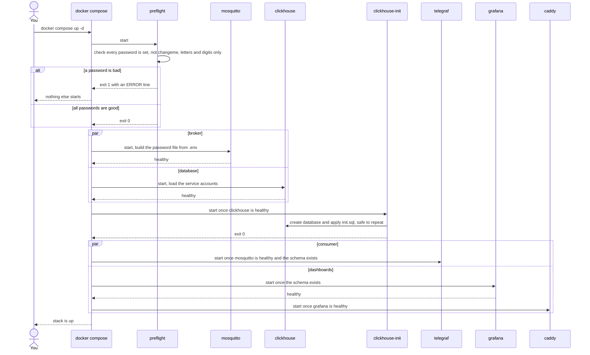
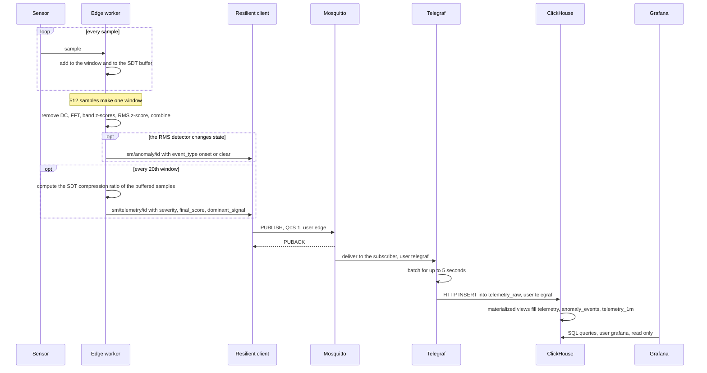
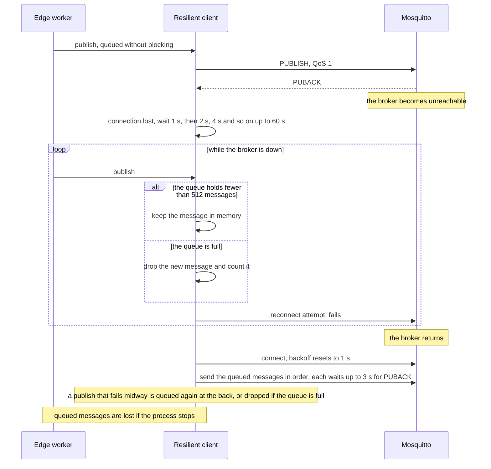

# Architecture

The diagrams follow the [C4 model](https://c4model.com) levels (context, containers, components) and add a deployment view, the data model and three sequence diagrams. They are [Mermaid](https://mermaid.js.org), so GitHub renders them and CI checks that they parse. Every statement below was checked against the code at the time of writing; if you change behaviour, change the diagram in the same pull request.

Related: [DOC.md](DOC.md) (concept and algorithms), [OPERATIONS.md](OPERATIONS.md) (running it), [TESTING.md](TESTING.md) (what CI verifies).

## 1. System context

Who and what interacts with AVENGE.

## 2. Containers

The deployable units and the protocols between them. Names match `edge/compose.yaml` and `core/compose.yaml`.

`preflight` (credential checks) is also a one-shot container; it appears in the startup sequence in section 6.

## 3. Components of the edge engine

Inside the `edge-filter` process (`edge/`). One worker goroutine per sensor processes fixed windows of samples.

Notes: `Send` drops a sample when the worker's input buffer is full, which is right for a live sensor. `SendBlocking` applies backpressure instead and is used for replayed input (file or pipe), so replays are reproducible.

## 4. Deployment and exposure

Which ports are reachable from where. MQTT is the only service meant to be reachable from other machines.

Set `MQTT_BIND` to the host's LAN address so the Pi can connect; the default `127.0.0.1` keeps the broker local. MQTT is not encrypted, so keep it on a trusted network.

## 5. Data model

How a message becomes rows. Retention is applied by ClickHouse TTLs (see [OPERATIONS.md](OPERATIONS.md#data-retention)).

## 6. Sequences

### Startup: one command

`docker compose up -d` orders everything with `depends_on` conditions. A bad password stops the whole start at `preflight`.

### Data path: from sample to dashboard

### Broker outage and recovery

What the edge does when the broker disappears. The queue lives in memory only.

## Notes and limits

- **Anomaly events come from the RMS detector only.** A message on `sm/anomaly/...` is published when the RMS detector changes state, and its `event_type` is `onset` only while that detector reports an anomaly; every other transition, including a first warning, is labelled `clear`. The combined severity (RMS and frequency bands) travels in the telemetry messages, so a fault visible only in a frequency band shows up in telemetry but may produce no anomaly event.
- **Outage buffer.** With the default cadence the queue of 512 messages holds roughly `512 × 20 × 512 / sample_rate` seconds of telemetry: about 87 minutes at 1 kHz and 55 minutes at 1.6 kHz. This is derived from the code, not measured.
- **SDT is a measurement, not a payload.** The engine compresses the buffered samples to report the compression ratio (`sdt_ratio`); the compressed points are not transmitted. One telemetry message summarizes a whole flush interval.
- **Allocations.** After initialization the per-window path (ring buffer, FFT, both detectors, scoring) does not allocate; tests enforce this. A window that emits an event allocates the event and a copy of the band states (a few small objects), because they are handed to another goroutine. This is a measured property of the code on amd64 with Go 1.22; the Raspberry Pi has not been measured.
- **Timestamps from the serial port are synthesized.** The firmware sends no timestamps; the reader derives them from a counter and `SENSOR_SAMPLE_RATE`, so that value must match the firmware's real rate.
- **No transport encryption.** MQTT is plaintext, authenticated and ACL-restricted; run it on a trusted network.
